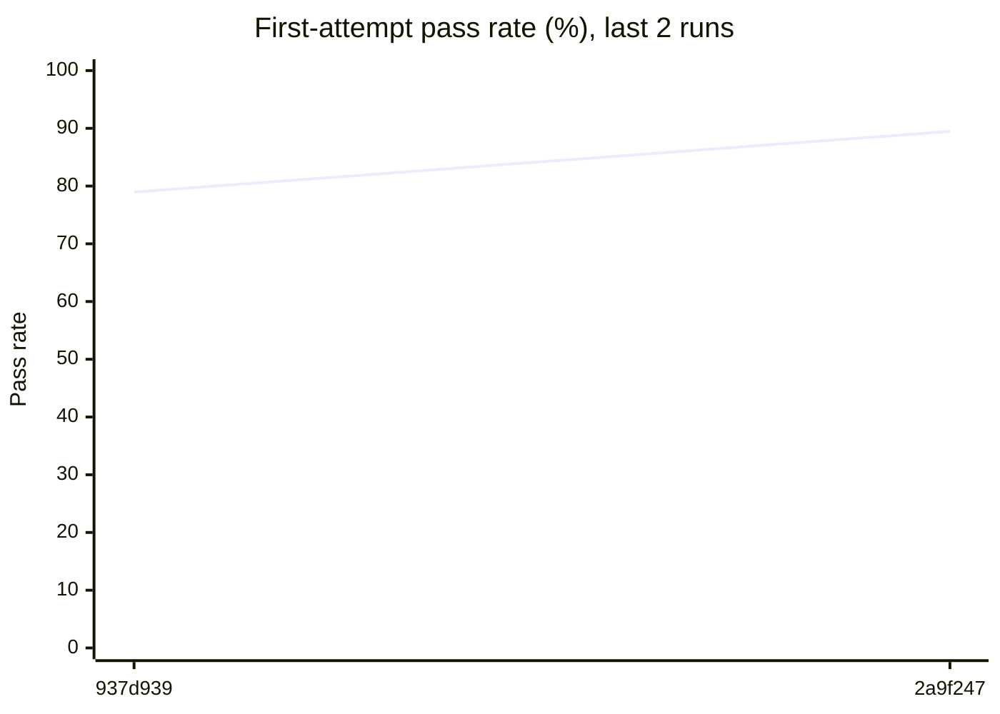
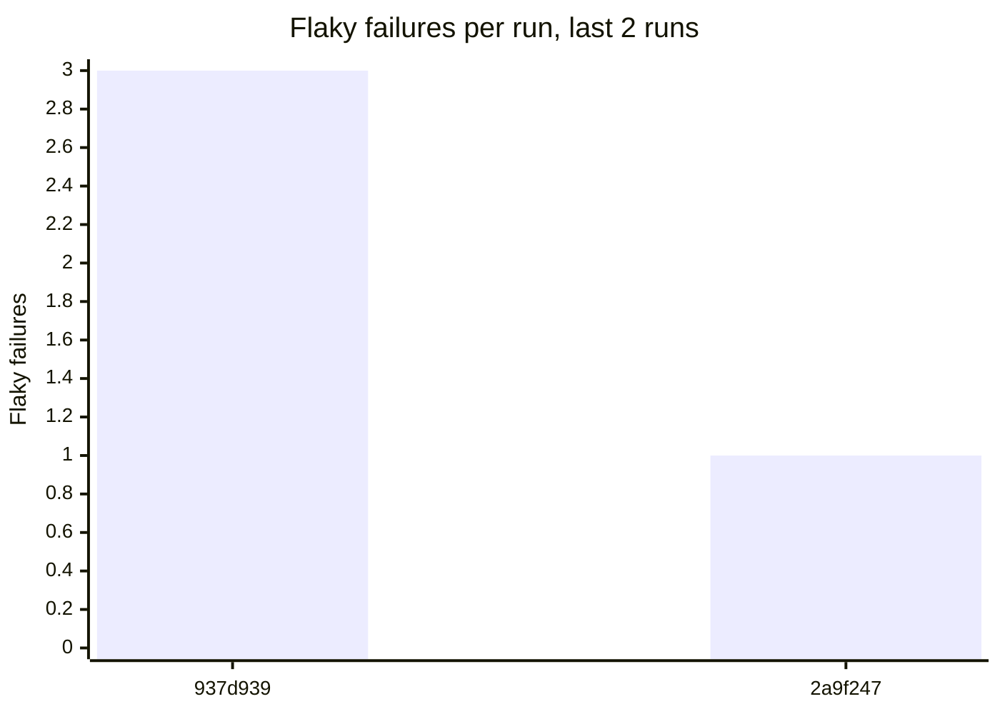
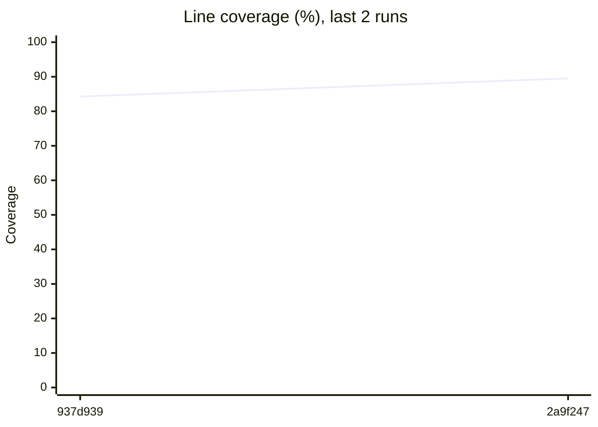

# Flaky test report

**Runs analysed:** 2 (2 on main, 0 from pull requests) · **Tests tracked:** 19 · **Flaky:** 4 (🔴 0 critical, 🟠 0 high, 🟡 4 medium, ⚪ 0 low) · **Consistently failing:** 1

## This run

main · commit `2a9f247` · Pin detector to fcbe75aeca9ff191a0e95997efad479666029852

| Test | Verdict | Severity | Message |
| --- | --- | --- | --- |
| `tests.test_bank.test_concurrent_deposits_are_not_lost` | 🔁 flaky: failed, then passed on retry | 🟡 medium | assert 51 == 400  +  where 51 = <lab.bank.Account object at 0x7fb78eee7fb0>.balance |
| `tests.test_stats.test_mean_of_high_readings` | ❌ failure: no evidence of flakiness, likely a real failure |  | ZeroDivisionError: division by zero |

## Flaky tests

A test is flaky when it passed and failed on identical code (same test, conftest, dependency manifests and executed source files). *Flaky code since* is the first run on the code state that turned out flaky. The commit before it is the most likely place the flake started.

| Severity | Test | Fail rate | Flips | Broke main | First flaky failure | Flaky code since | Last failure |
| --- | --- | --- | --- | --- | --- | --- | --- |
| 🟡 medium | `tests.test_bank.test_concurrent_deposits_are_not_lost` | 33% (1/3) | 2 | 1 | `2a9f247` main 2026-10-22 | `937d939` main 2026-10-22 (oldest run in history) | `2a9f247` main 2026-10-22 |
| 🟡 medium | `tests.test_service.test_call_right_after_start` | 33% (1/3) | 1 | 1 | `937d939` main 2026-10-22 | `937d939` main 2026-10-22 (oldest run in history) | `937d939` main 2026-10-22 |
| 🟡 medium | `tests.test_settings.test_default_currency` | 33% (1/3) | 1 | 1 | `937d939` main 2026-10-22 | `937d939` main 2026-10-22 (oldest run in history) | `937d939` main 2026-10-22 |
| 🟡 medium | `tests.test_storage.test_write_and_read_back` | 33% (1/3) | 1 | 1 | `937d939` main 2026-10-22 | `937d939` main 2026-10-22 (oldest run in history) | `937d939` main 2026-10-22 |

## Consistently failing tests

These fail on their current code and have never passed on it: likely real breakages, not flakes.

| Test | Failing since | Failures |
| --- | --- | --- |
| `tests.test_stats.test_mean_of_high_readings` | `937d939` main 2026-10-22 | 4 |

## Trends

## Coverage

**Total:** 89.52% of 248 statements (+5.25 vs main at `937d939`)

### Files no test executes

- `lab/node.py`

### Files below 80% coverage

| File | Coverage | Missing lines |
| --- | --- | --- |
| `lab/node.py` | 0.0% | 3, 5-7, 9, 12-18, 21-22 |

## Graph data

- `runs.csv`: one row per run: pass rate, failures, flaky failures, coverage, diff coverage
- `runs.json`: same as runs.csv, as JSON
- `test_outcomes.csv`: every test attempt in every run (long format, for heatmaps)
- `flaky_tests.json`: flaky and failing tests with stats, onset and per-run timeline
- `coverage_files.csv`: per-file coverage for the latest run with coverage
- `coverage_gaps.json`: files below threshold, never-executed files, uncovered changed lines
