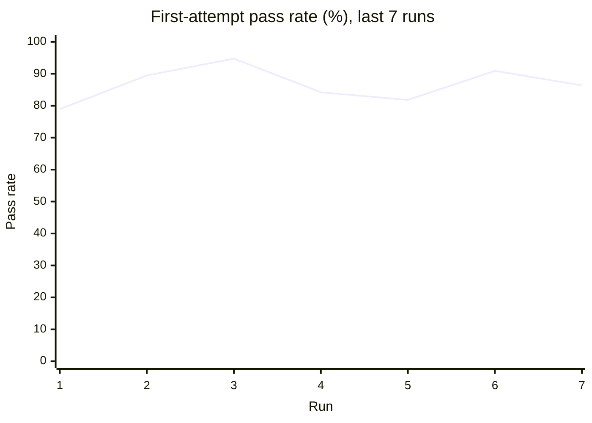
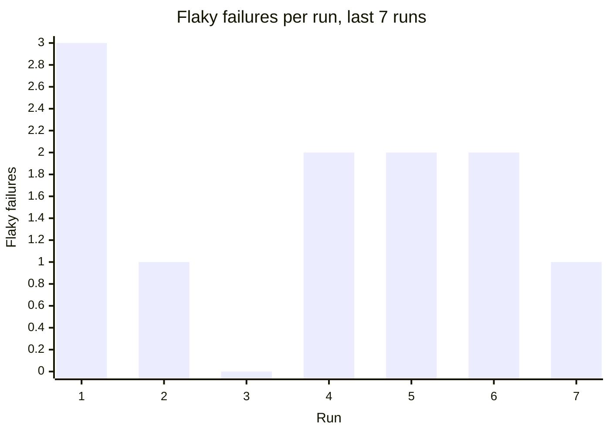

# Flaky test report

**Runs analysed:** 7 (7 on main, 0 from pull requests) · **Tests tracked:** 63 · **Flaky:** 9 (🔴 0 critical, 🟠 2 high, 🟡 7 medium, ⚪ 0 low) · **Consistently failing:** 3 · **Fixed flakes:** 0

## This run

main · commit `2fc446b` · Note detector version on its pin

| Test | Verdict | Severity | Message |
| --- | --- | --- | --- |
| `tests.test_quotes.test_fetch_quote [PST]` | 🔁 flaky: failed, then passed on retry | 🟠 high | TimeoutError: timed out |
| `tests.test_reports.test_report_date_early_morning [PST]` | ❌ failure: no evidence of flakiness, likely a real failure |  | AssertionError: assert '2026-02-28' == '2026-03-01'      - 2026-03-01   + 2026-02-28 |
| `tests.test_stats.test_mean_of_high_readings [PST]` | ❌ failure: no evidence of flakiness, likely a real failure |  | ZeroDivisionError: division by zero |

## Flaky tests

A test is flaky when it passed and failed on identical code (same test, conftest, dependency manifests and executed source files). *Flaky code since* is the first run on the code state that turned out flaky. The commit before it is the most likely place the flake started.

| Severity | Test | Fail rate | Flips | Broke main | First flaky failure | Flaky code since | Last failure |
| --- | --- | --- | --- | --- | --- | --- | --- |
| 🟠 high | `tests.test_quotes.test_fetch_quote [PST]` | 50% (2/4) | 3 | 2 | `fa08883` main 2026-10-22 | `fa08883` main 2026-10-22 (oldest run in history) | `2fc446b` main 2026-10-22 |
| 🟠 high | `tests.test_settings.test_default_currency` | 33% (2/6) | 3 | 2 | `937d939` main 2026-10-22 | `937d939` main 2026-10-22 (oldest run in history) | `f1831d1` main (schedule) 2026-10-22 |
| 🟡 medium | `tests.test_service.test_call_right_after_start [UTC]` | 50% (1/2) | 1 | 1 | `fa08883` main 2026-10-22 | `fa08883` main 2026-10-22 (oldest run in history) | `fa08883` main 2026-10-22 |
| 🟡 medium | `tests.test_stats.test_mean_of_high_readings [UTC]` | 50% (1/2) | 1 | 1 | `fa08883` main 2026-10-22 | `fa08883` main 2026-10-22 (oldest run in history) | `fa08883` main 2026-10-22 |
| 🟡 medium | `tests.test_settings.test_default_currency [PST]` | 33% (1/3) | 1 | 1 | `fa08883` main 2026-10-22 | `fa08883` main 2026-10-22 (oldest run in history) | `fa08883` main 2026-10-22 |
| 🟡 medium | `tests.test_bank.test_concurrent_deposits_are_not_lost` | 20% (1/5) | 2 | 1 | `2a9f247` main 2026-10-22 | `937d939` main 2026-10-22 (oldest run in history) | `2a9f247` main 2026-10-22 |
| 🟡 medium | `tests.test_cluster.test_map_across_nodes` | 20% (1/5) | 2 | 1 | `f1831d1` main (schedule) 2026-10-22 | `937d939` main 2026-10-22 (oldest run in history) | `f1831d1` main (schedule) 2026-10-22 |
| 🟡 medium | `tests.test_service.test_call_right_after_start` | 20% (1/5) | 1 | 1 | `937d939` main 2026-10-22 | `937d939` main 2026-10-22 (oldest run in history) | `937d939` main 2026-10-22 |
| 🟡 medium | `tests.test_storage.test_write_and_read_back` | 20% (1/5) | 1 | 1 | `937d939` main 2026-10-22 | `937d939` main 2026-10-22 (oldest run in history) | `937d939` main 2026-10-22 |

## Consistently failing tests

These fail on their current code and have never passed on it: likely real breakages, not flakes.

| Test | Failing since | Failures |
| --- | --- | --- |
| `tests.test_stats.test_mean_of_high_readings` | `937d939` main 2026-10-22 | 8 |
| `tests.test_reports.test_report_date_early_morning [PST]` | `fa08883` main 2026-10-22 | 4 |
| `tests.test_stats.test_mean_of_high_readings [PST]` | `fa08883` main 2026-10-22 | 4 |

## Trends





```mermaid
xychart-beta
    title "Line coverage (%), last 7 runs"
    x-axis "Run" [1, 2, 3, 4, 5, 6, 7]
    y-axis "Coverage" 0 --> 100
    line [84.27, 89.52, 88.71, 90.73, 88.61, 86.83, 89.32]
```

<details><summary>Run key</summary>

| Run | Commit | Where | Date |
| --- | --- | --- | --- |
| 1 | `937d939` | main | 2026-10-22 |
| 2 | `2a9f247` | main | 2026-10-22 |
| 3 | `f1831d1` | main | 2026-10-22 |
| 4 | `f1831d1` | main (schedule) | 2026-10-22 |
| 5 | `fa08883` | main | 2026-10-22 |
| 6 | `fa08883` | main | 2026-10-22 |
| 7 | `2fc446b` | main | 2026-10-22 |

</details>

## Coverage

**Total:** 89.32% of 281 statements (+2.49 vs main at `fa08883`)

### Files no test executes

- `lab/node.py`

### Files below 80% coverage

| File | Coverage | Missing lines |
| --- | --- | --- |
| `lab/node.py` | 0.0% | 3, 5-7, 9, 12-18, 21-22 |

## Graph data

- `runs.csv`: one row per run: pass rate, failures, flaky failures, coverage, diff coverage
- `runs.json`: same as runs.csv, as JSON
- `test_outcomes.csv`: every test attempt in every run (long format, for heatmaps)
- `flaky_tests.json`: flaky and failing tests with stats, onset and per-run timeline
- `coverage_files.csv`: per-file coverage for the latest run with coverage
- `coverage_gaps.json`: files below threshold, never-executed files, uncovered changed lines
